# Домашнее задание к занятию 4 «Оркестрация группой Docker контейнеров на примере Docker Compose»

Задание: https://github.com/netology-code/virtd-homeworks/blob/shvirtd-1/05-virt-03-docker-intro/README.md

Все команды выполнялись на ВМ в Yandex Cloud (Ubuntu).

---

## Задача 1

Установлены Docker Engine 29.9.3 и Docker Compose plugin v5.7.0 (Ubuntu 24.04). Docker Hub из облака доступен, зеркала в `daemon.json` не понадобились.

Ссылка на репозиторий: https://hub.docker.com/repository/docker/rostorguev/custom-nginx/general
(публичная страница: https://hub.docker.com/r/rostorguev/custom-nginx)

Файлы: [task1/Dockerfile](task1/Dockerfile), [task1/index.html](task1/index.html)

```dockerfile
FROM nginx:1.29.0
COPY index.html /usr/share/nginx/html/index.html
```

Команды:

```bash
docker pull nginx:1.29.0
docker build -t custom-nginx:1.0.0 .
docker tag custom-nginx:1.0.0 rostorguev/custom-nginx:1.0.0
docker push rostorguev/custom-nginx:1.0.0
```

При `push` слои базового образа помечены `Mounted from library/nginx`: они уже есть на Docker Hub, поэтому загружается только новый слой с `index.html` и служебные данные образа.

---

## Задача 2

Docker не принимает кириллицу в именах контейнеров, поэтому ФИО записано латиницей.

```bash
docker run -d --name rostorguev-nikita-custom-nginx-t2 -p 127.0.0.1:8080:80 custom-nginx:1.0.0
docker rename rostorguev-nikita-custom-nginx-t2 custom-nginx-t2
date +"%d-%m-%Y %T.%N %Z" ; sleep 0.150 ; docker ps ; ss -tlpn | grep 127.0.0.1:8080 ; docker logs custom-nginx-t2 -n1 ; docker exec -it custom-nginx-t2 base64 /usr/share/nginx/html/index.html
curl http://127.0.0.1:8080
```

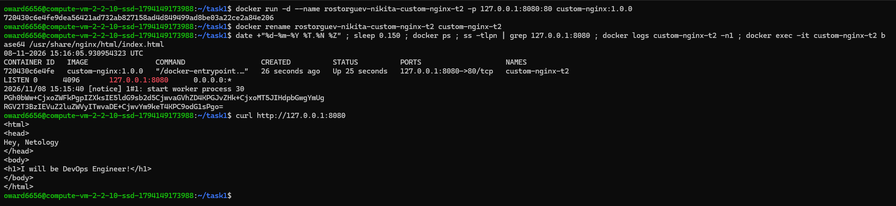

После переименования ID контейнера (`720430c6e4fe`) и проброс порта `127.0.0.1:8080->80/tcp` остались прежними. Индекс-страница отдаётся по `curl`.

---

## Задача 3

### 1–4. Подключение к потокам контейнера, Ctrl-C, перезапуск

```bash
docker attach custom-nginx-t2   # затем Ctrl-C
docker ps -a
docker start custom-nginx-t2
```

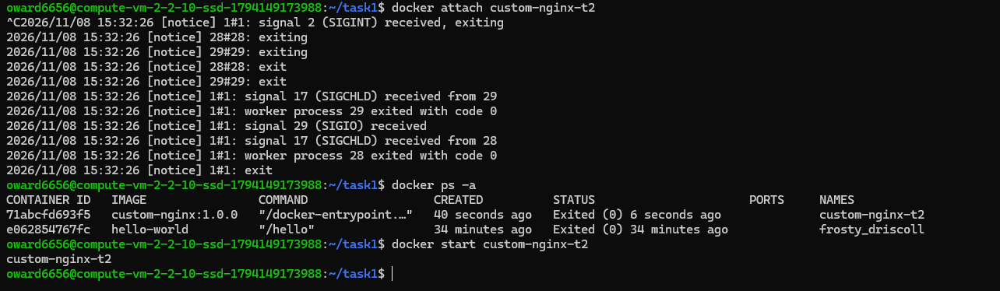

**Почему контейнер остановился.** `docker attach` подключает терминал к стандартным потокам главного процесса контейнера (PID 1, мастер-процесс nginx). Ctrl-C отправляет ему сигнал SIGINT. Это видно в логе: `1#1: signal 2 (SIGINT) received, exiting`. Nginx завершает воркеры и выходит сам. Контейнер живёт ровно столько, сколько живёт его PID 1, поэтому вместе с процессом остановился и контейнер: в `docker ps -a` статус `Exited (0)`.

### 5–9. Смена порта nginx внутри контейнера

```bash
docker exec -it custom-nginx-t2 bash
apt-get update
apt-get install -y nano
nano /etc/nginx/conf.d/default.conf   # listen 80; -> listen 81;
nginx -s reload
curl http://127.0.0.1:80
curl http://127.0.0.1:81
exit
```

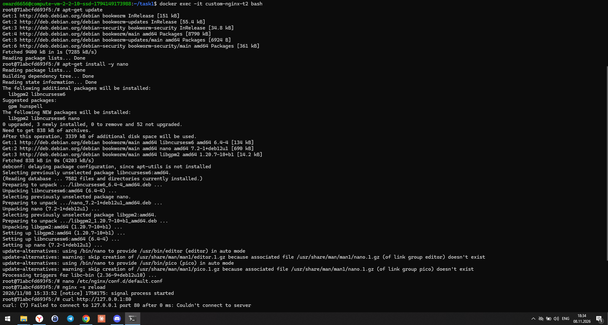
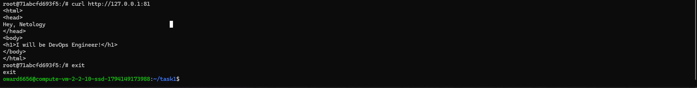

### 10. Проверка с хоста

```bash
ss -tlpn | grep 127.0.0.1:8080
docker port custom-nginx-t2
curl http://127.0.0.1:8080
```

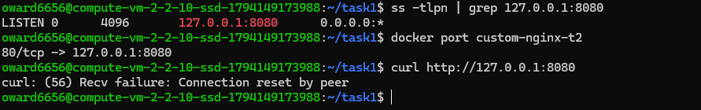

**В чём проблема.** Порт `127.0.0.1:8080` на хосте по-прежнему слушается: его держит `docker-proxy`. По `docker port` проброс всё ещё ведёт в порт **80** контейнера. Но nginx после правки конфига слушает **81**, а на 80 внутри контейнера никого нет. Прокси принимает соединение, не может передать его в контейнер и сбрасывает: `Connection reset by peer`. Проброс портов задаётся один раз при `docker run` и не отслеживает изменения внутри контейнера.

### 11. (Дополнительно) Исправление проброса без удаления контейнера

Параметры, заданные при `docker run`, Docker хранит в `/var/lib/docker/containers/<ID>/`: `PortBindings` лежат в `hostconfig.json`, `ExposedPorts` в `config.v2.json`. Останавливаем контейнер и демон Docker (иначе при остановке он перезапишет файлы из памяти), меняем `80/tcp` на `81/tcp` и запускаем обратно. Конфигурация nginx не менялась, контейнер не удалялся.

```bash
docker stop custom-nginx-t2
sudo systemctl stop docker.socket
sudo systemctl stop docker
sudo -i
cd /var/lib/docker/containers/<ID>
cp hostconfig.json hostconfig.json.bak
cp config.v2.json config.v2.json.bak
sed -i 's#"80/tcp"#"81/tcp"#g' hostconfig.json
sed -i 's#"80/tcp"#"81/tcp"#g' config.v2.json
exit
sudo systemctl start docker
docker start custom-nginx-t2
docker port custom-nginx-t2     # 81/tcp -> 127.0.0.1:8080
curl http://127.0.0.1:8080
```

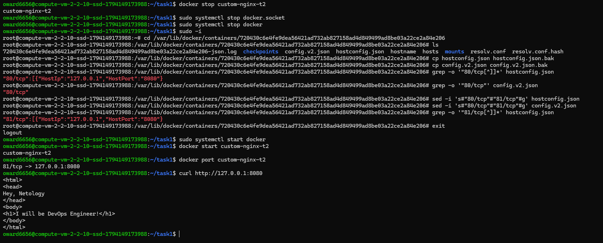

Шаг 11 выполнялся на первом экземпляре контейнера `custom-nginx-t2` (ID `720430c6e4fe`) с той же конфигурацией. Шаги 1–10 сняты на пересозданном контейнере (ID `71abcfd693f5`).

### 12. Удаление запущенного контейнера без остановки

Для этого шага контейнер был заново запущен той же командой, что в задаче 2 (`docker run -d --name custom-nginx-t2 -p 127.0.0.1:8080:80 custom-nginx:1.0.0`).

```bash
docker ps
docker rm -f custom-nginx-t2
docker ps -a
```

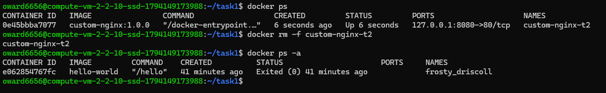

Флаг `-f` сам отправляет контейнеру SIGKILL и удаляет его, отдельный `docker stop` не нужен.

---

## Задача 4

Главный процесс образов centos и debian — `bash`. Без терминала он сразу завершается, и контейнер останавливается. Поэтому для работы в фоне контейнерам передана команда `sleep infinity`.

```bash
docker run -d --name centos-t4 -v $(pwd):/data centos:7 sleep infinity
docker run -d --name debian-t4 -v $(pwd):/data debian:12 sleep infinity
docker ps
docker exec -it centos-t4 bash
  echo "Hello from CentOS container" > /data/centos.txt
  exit
echo "Hello from host" > host.txt
docker exec -it debian-t4 bash
  ls -l /data
  cat /data/centos.txt
  cat /data/host.txt
  exit
```

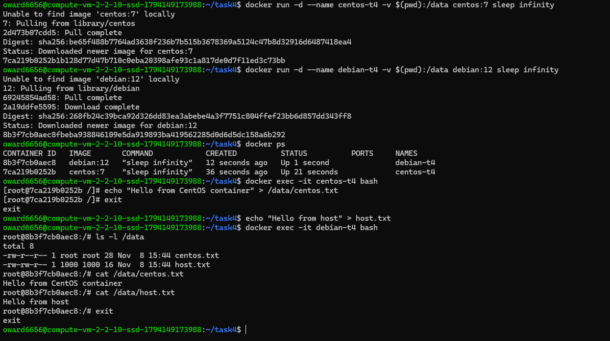

Оба контейнера и хост работают с одной и той же папкой (bind mount), поэтому в Debian видны и файл из CentOS, и файл с хоста. `centos.txt` принадлежит `root`: его создал root внутри контейнера. `host.txt` показан с UID `1000`: это пользователь хоста, которого в образе debian нет по имени.

---

## Задача 5

### 1. Какой файл запустился

В папке `/tmp/netology/docker/task5` лежат `compose.yaml` (portainer) и `docker-compose.yaml` (registry). После `docker compose up -d` запустился только **`compose.yaml`**:

```
WARN[0000] Found multiple config files with supported names: .../compose.yaml, .../docker-compose.yaml
WARN[0000] Using /tmp/netology/docker/task5/compose.yaml
```

Без флага `-f` Compose ищет в текущей папке файл с одним из стандартных имён. Основным (каноническим) считается `compose.yaml`, а `docker-compose.yaml` поддерживается для обратной совместимости. Когда в папке есть оба, берётся основной, а второй игнорируется ([документация](https://docs.docker.com/compose/intro/compose-application-model/#the-compose-file)).

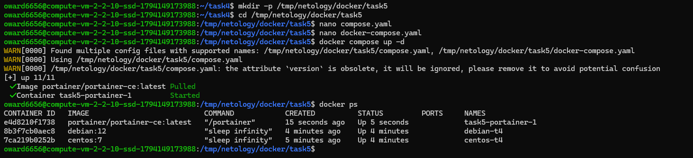

### 2. Запуск обоих файлов через `include`

Итоговый [compose.yaml](task5/compose.yaml):

```yaml
version: "3"
include:
  - docker-compose.yaml
services:
  portainer:
    network_mode: host
    image: portainer/portainer-ce:latest
    volumes:
      - /var/run/docker.sock:/var/run/docker.sock
```

`include` подключает сервисы из другого compose-файла в текущий проект. Теперь запускаются и portainer, и registry.

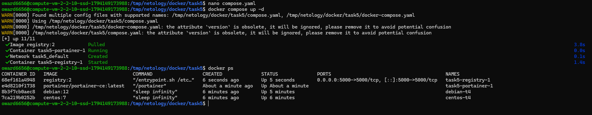

Предупреждение `the attribute version is obsolete` означает, что современный Compose игнорирует поле `version`. Оно оставлено, потому что так дано в задании.

### 3. Образ custom-nginx в локальном registry

```bash
docker tag custom-nginx:1.0.0 127.0.0.1:5000/custom-nginx:latest
docker push 127.0.0.1:5000/custom-nginx:latest
curl http://127.0.0.1:5000/v2/_catalog
```

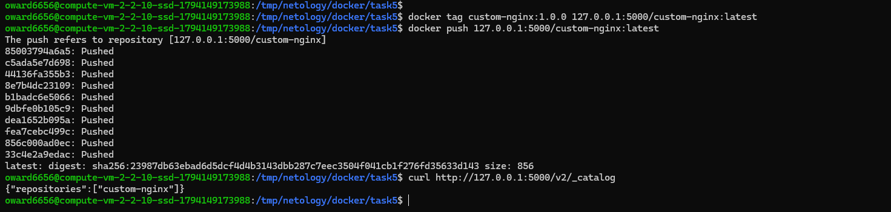

Адрес registry в начале имени образа подсказывает Docker, куда его отправить. Digest совпадает с образом на Docker Hub (`sha256:23987db6...`): это тот же образ.

### 4–5. Portainer и деплой стека

Portainer слушает `127.0.0.1:9000` на ВМ. Доступ с рабочей станции сделан через SSH-туннель:

```powershell
ssh -i $HOME\.ssh\oward6656 -L 9000:127.0.0.1:9000 -L 9090:127.0.0.1:9090 oward6656@158.160.150.97
```

Portainer 2.45 при начальной настройке, кроме логина и пароля, требует **Setup token** из лога сервера: `docker logs task5-portainer-1 | grep -i token`.

Стек `nginx` задеплоен через Stacks → Add stack → Web editor:

```yaml
version: '3'

services:
  nginx:
    image: 127.0.0.1:5000/custom-nginx
    ports:
      - "9090:80"
```

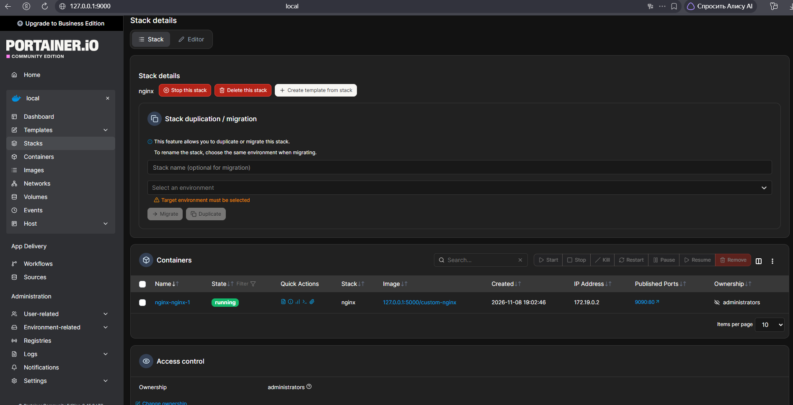

Страница из образа, взятого из локального registry, открывается на порту 9090:


### 6. Inspect контейнера (Config)

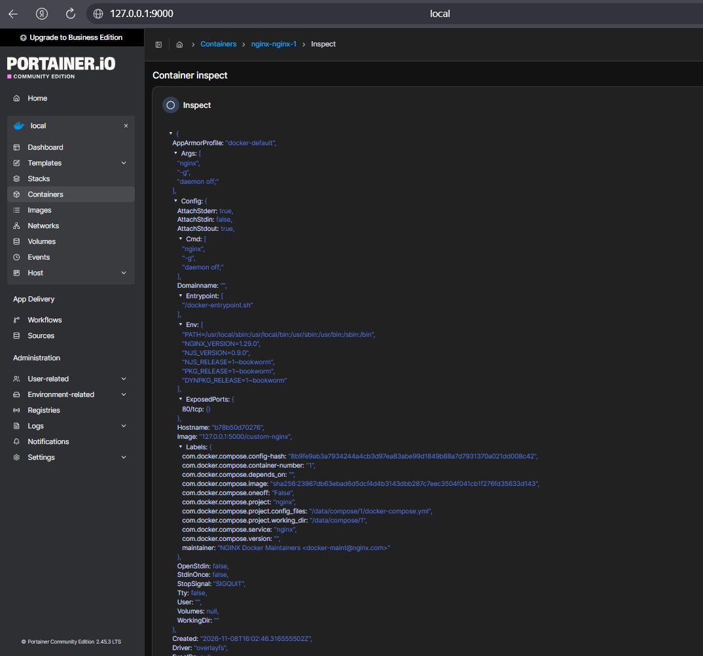
